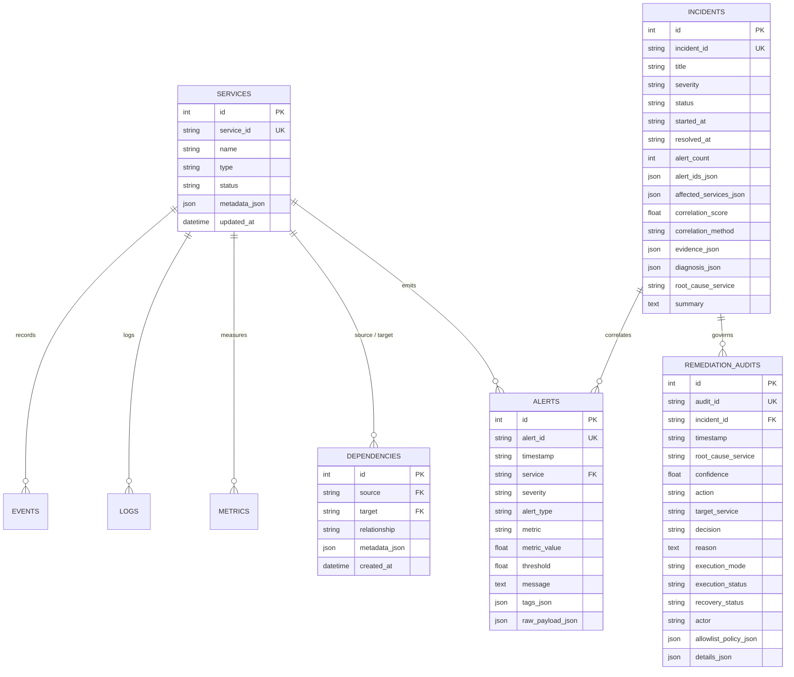

# OpsPilot — Low-Level Design (LLD)

**Project Title:** OpsPilot — Autonomous Incident Correlation & Safe Self-Healing Infrastructure Bot  
**Document Type:** Low-Level Design (LLD)  
**Target Runtime:** Python 3.10+ (FastAPI) & Node.js 18+ (React 19)  
**Version:** 1.0.0  
**Status:** Approved / Implemented  

---

## Table of Contents
1. [Module Decomposition & Package Hierarchy](#1-module-decomposition--package-hierarchy)
2. [Data Models & Schema Specifications](#2-data-models--schema-specifications)
   - [2.1 Database Models (SQLAlchemy)](#21-database-models-sqlalchemy)
   - [2.2 Domain & Pydantic Transfer Models](#22-domain--pydantic-transfer-models)
3. [Component & Class Design](#3-component--class-design)
   - [3.1 Ingestion & Adapter Subsystem](#31-ingestion--adapter-subsystem)
   - [3.2 Topology Engine & Discovery Subsystem](#32-topology-engine--discovery-subsystem)
   - [3.3 8-D Correlation & Clustering Subsystem](#33-8-d-correlation--clustering-subsystem)
   - [3.4 Dual-Engine Root Cause Analysis Subsystem](#34-dual-engine-root-cause-analysis-subsystem)
   - [3.5 Remediation & Safety Gate Subsystem](#35-remediation--safety-gate-subsystem)
   - [3.6 Recovery Verification Subsystem](#36-recovery-verification-subsystem)
   - [3.7 Frontend State Management & Component Hierarchy](#37-frontend-state-management--component-hierarchy)
4. [REST API Specifications & Interface Contracts](#4-rest-api-specifications--interface-contracts)
5. [Storage Architecture & Database Schema](#5-storage-architecture--database-schema)
6. [Algorithmic Workflows & Execution Details](#6-algorithmic-workflows--execution-details)
   - [6.1 8-Dimensional Pairwise Similarity Computation](#61-8-dimensional-pairwise-similarity-computation)
   - [6.2 Connected Component Incident Clustering](#62-connected-component-incident-clustering)
   - [6.3 Topological Root Cause Graph Traversal](#63-topological-root-cause-graph-traversal)
   - [6.4 10-Condition Deterministic Safety Gate Evaluation](#64-10-condition-deterministic-safety-gate-evaluation)
   - [6.5 Multi-Signal Recovery & Synthetic Probing](#65-multi-signal-recovery--synthetic-probing)
7. [Error Handling, Edge Cases & Guardrails](#7-error-handling-edge-cases--guardrails)
8. [Traceability Matrix to Implementation Files](#8-traceability-matrix-to-implementation-files)

---

## 1. Module Decomposition & Package Hierarchy

The repository source tree is organized into three decoupled application domains:

```
HACKATHON/
├── backend/app/                     # Core OpsPilot AIOps Backend Engine
│   ├── main.py                      # FastAPI entrypoint, lifespan startup, CORS
│   ├── config.py                    # Pydantic BaseSettings environment config
│   ├── api/
│   │   └── routes/                  # Modular APIRouters
│   │       ├── health.py            # /health, /api/reset
│   │       ├── services.py          # /api/services
│   │       ├── topology.py          # /api/topology, /api/topology/discover
│   │       ├── alerts.py            # /api/alerts
│   │       ├── metrics.py           # /api/metrics
│   │       ├── logs.py              # /api/logs
│   │       ├── events.py            # /api/events
│   │       ├── sync.py              # /api/sync/shopflow
│   │       ├── correlation.py       # /api/correlation/run, /api/correlation/benchmark
│   │       └── incidents.py         # /api/incidents/* (RCA, Safety Gate, Remediate, Audit)
│   ├── database/
│   │   ├── session.py               # SQLite engine, sessionmaker, Base, init_db()
│   │   ├── models.py                # Declarative SQLAlchemy ORM models
│   │   └── repository.py            # TelemetryRepository data access methods
│   ├── ingestion/
│   │   ├── adapter.py               # ShopFlowAdapter HTTP client
│   │   └── service.py               # IngestionService orchestration
│   ├── topology/
│   │   ├── graph.py                 # DependencyGraph (NetworkX in-memory wrapper)
│   │   ├── discovery.py             # TopologyDiscoveryEngine (runtime inference)
│   │   ├── discovery_models.py      # DiscoveredNode, DiscoveredEdge, DiscoveredTopologyResult
│   │   ├── telemetry_source.py      # TelemetrySource adapter
│   │   └── grafana_source.py        # GrafanaTelemetrySource proxy client
│   ├── correlation/
│   │   ├── models.py                # PairwiseScore, CorrelationEvidence, Incident
│   │   ├── scoring.py               # 8-D vector dot product formulas and weights
│   │   ├── clustering.py            # Connected components graph clustering
│   │   ├── service.py               # CorrelationService orchestration
│   │   └── strategies/              # DependencyAwareStrategy, TimeOnlyStrategy
│   ├── root_cause/
│   │   ├── models.py                # RootCauseAnalysis, ConfidenceBreakdown
│   │   ├── analyzer.py              # RCA orchestration
│   │   ├── fallback.py              # FallbackRCAEngine (deterministic graph traverser)
│   │   ├── llm_client.py            # LLMClient (OpenAI-compatible schema-bounded client)
│   │   └── prompt_builder.py        # Grounded system & user prompt templates
│   └── remediation/
│       ├── models.py                # SafetyGateResult, RemediationResult, RecoveryEvidence
│       ├── allowlist.py             # RemediationAllowlist YAML loader & validator
│       ├── safety_gate.py           # RemediationSafetyGate (10 deterministic checks)
│       ├── recovery.py              # RecoveryVerifier (4-signal probe validator)
│       └── service.py               # RemediationService execution coordinator
│
├── frontend/src/                    # OpsPilot Operations Console (React 19 + Vite)
│   ├── main.tsx                     # React DOM root mounting
│   ├── App.tsx                      # Primary shell layout, tab routing, status bar
│   ├── context/
│   │   └── OpsPilotContext.tsx      # Global state provider (polling, actions, selection)
│   ├── api/
│   │   ├── client.ts                # Axios/Fetch API client wrapper
│   │   └── types.ts                 # TypeScript interfaces mirroring backend Pydantic models
│   └── components/
│       ├── Header/                  # TopNavbar, KpiSummaryBar, HeroIncidentBanner
│       ├── Topology/                # TopologyGraph (React Flow), ServiceNode
│       ├── Alerts/                  # AlertFeed (filtering, search, severity badges)
│       ├── Incidents/               # IncidentList (status filters, correlation badges)
│       ├── Correlation/             # CorrelationEvidence, BenchmarkModal
│       ├── RootCause/               # RootCauseCard, ConfidenceBreakdown
│       ├── Remediation/             # SafetyGateMatrix, RemediationControl
│       ├── Recovery/                # RecoveryBanner (probe latency, status)
│       └── Audit/                   # AuditTimeline (hash chain, parameter inspect)
│
└── shopflow-test/                   # Realistic Target Platform (E-Commerce Microservices)
    ├── services/                    # api_gateway, auth_service, order_api, checkout_api, product_api
    ├── chaos/                       # ChaosEngine, scenario definitions (DB cascade, latency)
    ├── telemetry/                   # In-process AlertGenerator, MetricCollector, Logger
    └── config/                      # services.yaml, topology.yaml, scenarios.yaml
```

---

## 2. Data Models & Schema Specifications

### 2.1 Database Models (SQLAlchemy)
Defined in [`backend/app/database/models.py`](backend/app/database/models.py):

| Model Name | Table Name | Key Columns | Description |
| :--- | :--- | :--- | :--- |
| `ServiceModel` | `services` | `id`, `service_id` (UQ), `name`, `type`, `status`, `metadata_json`, `updated_at` | Catalog of monitored services and runtime statuses. |
| `DependencyModel` | `dependencies` | `id`, `source`, `target`, `relationship`, `metadata_json`, `created_at` | Directed caller-callee edges with composite index `(source, target)`. |
| `AlertModel` | `alerts` | `id`, `alert_id` (UQ), `timestamp`, `service`, `severity`, `alert_type`, `metric`, `metric_value`, `threshold`, `message`, `source`, `dependency`, `tags_json` | Stored raw and synthesized telemetry alerts. |
| `MetricModel` | `metrics` | `id`, `timestamp`, `service`, `metric_name`, `value`, `unit`, `tags_json` | Ingested metric time-series measurements. |
| `LogModel` | `logs` | `id`, `log_id` (UQ), `timestamp`, `service`, `level`, `event`, `message`, `request_id`, `dependency`, `latency_ms`, `status_code`, `metadata_json` | Structured JSON application access and error logs. |
| `EventModel` | `events` | `id`, `event_id` (UQ), `timestamp`, `service`, `event_type`, `message`, `metadata_json` | System lifecycle events and deployment markers. |
| `IncidentModel` | `incidents` | `id`, `incident_id` (UQ), `title`, `severity`, `status`, `started_at`, `updated_at`, `resolved_at`, `alert_count`, `alert_ids_json`, `affected_services_json`, `correlation_score`, `correlation_method`, `evidence_json`, `diagnosis_json`, `root_cause_service`, `summary` | Correlated multi-alert incident aggregates with RCA and evidence. |
| `RemediationAuditModel`| `remediation_audits` | `id`, `audit_id` (UQ), `incident_id`, `timestamp`, `root_cause_service`, `confidence`, `action`, `target_service`, `decision`, `reason`, `execution_mode`, `execution_status`, `recovery_status`, `actor`, `allowlist_policy_json`, `details_json` | Immutable, append-only record of safety evaluations and executions. |

### 2.2 Domain & Pydantic Transfer Models

#### Correlation Models ([`backend/app/correlation/models.py`](backend/app/correlation/models.py))
```python
class PairwiseScore(BaseModel):
    alert_a_id: str
    alert_b_id: str
    service_a: str
    service_b: str
    total_score: float
    dependency_score: float
    graph_distance_score: float
    causal_order_score: float
    temporal_score: float
    service_score: float
    alert_type_score: float
    severity_score: float
    tag_and_metric_score: float
    reasons: List[str]

class Incident(BaseModel):
    incident_id: str
    title: str
    severity: str = "CRITICAL"
    status: str = "OPEN"
    created_at: str
    updated_at: str
    resolved_at: Optional[str] = None
    alert_count: int
    alert_ids: List[str]
    affected_services: List[str]
    correlation_score: float
    correlation_method: str = "dependency_aware"
    correlation_evidence: CorrelationEvidence
```

#### Root Cause Analysis Models ([`backend/app/root_cause/models.py`](backend/app/root_cause/models.py))
```python
class ConfidenceBreakdown(BaseModel):
    topological_clarity: float
    causal_consistency: float
    evidence_completeness: float
    symptom_breadth: float
    correlation_cohesion: float
    weights: Dict[str, float]
    formula: str

class RootCauseAnalysis(BaseModel):
    incident_id: str
    root_cause_service: str
    root_cause_summary: str
    confidence_score: float
    confidence_breakdown: ConfidenceBreakdown
    causal_narrative: str
    propagation_path: List[str]
    evidence_summary: List[str]
    recommended_action: str
    analysis_mode: str  # "llm" or "deterministic_fallback"
    model_used: Optional[str] = None
    diagnosed_at: str
```

#### Remediation Models ([`backend/app/remediation/models.py`](backend/app/remediation/models.py))
```python
class SafetyConditionCheck(BaseModel):
    condition_number: int
    name: str
    passed: bool
    detail: str

class SafetyGateResult(BaseModel):
    decision: SafetyDecision  # APPROVED, REJECTED, HUMAN_REVIEW
    allowed: bool
    action: str
    target_service: str
    execution_mode: ExecutionMode  # SIMULATION, REAL
    reason: str
    conditions: List[SafetyConditionCheck]
    allowlist_policy: Dict[str, Any]

class RecoveryEvidence(BaseModel):
    status: RecoveryStatus  # RECOVERED, NOT_RECOVERED, UNKNOWN
    healthy: bool
    active_alerts_count: int
    error_rate: Optional[float]
    latency_ms: Optional[float]
    checkout_successful: Optional[bool]
    probe_latency_ms: Optional[float]
    signals_evaluated: List[str]
    reasons: List[str]
```

---

## 3. Component & Class Design

### 3.1 Ingestion & Adapter Subsystem
- **`ShopFlowAdapter`** ([`backend/app/ingestion/adapter.py`](backend/app/ingestion/adapter.py)):
  - `check_connectivity() -> bool`: Verifies HTTP connection to ShopFlow `:8000`.
  - `fetch_topology() -> Dict[str, Any]`: Pulls service and edge catalog.
  - `fetch_alerts() -> List[Dict[str, Any]]`: Pulls active firing alerts.
  - `fetch_metrics() -> List[Dict[str, Any]]`: Pulls Prometheus-style time-series metrics.
  - `fetch_logs() -> List[Dict[str, Any]]`: Pulls structured access and error logs.
  - `execute_chaos_reset() -> bool`: Triggers target reset endpoint (`POST /api/chaos/reset`).
  - `probe_checkout() -> Tuple[bool, float]`: Dispatches live transaction probe (`POST /api/checkout`).
- **`IngestionService`** ([`backend/app/ingestion/service.py`](backend/app/ingestion/service.py)):
  - `sync_shopflow(db: Session) -> Dict[str, Any]`: Orchestrates ingestion, persistence, and topology edge feeding.

### 3.2 Topology Engine & Discovery Subsystem
- **`DependencyGraph`** ([`backend/app/topology/graph.py`](backend/app/topology/graph.py)):
  - Encapsulates a NetworkX `DiGraph`.
  - `add_service(service_id, name, type, ...)`: Adds node with metadata attributes.
  - `add_dependency(source, target, relationship, ...)`: Adds directed edge with weight/criticality.
  - `has_path(source, target) -> bool`: Computes topological reachability.
  - `shortest_path_distance(source, target) -> int`: Returns hop count ($\infty$ if disconnected).
  - `get_upstream_dependencies(service_id) -> List[str]`: Resolves direct caller nodes.
  - `get_downstream_dependencies(service_id) -> List[str]`: Resolves direct callee nodes.
- **`TopologyDiscoveryEngine`** ([`backend/app/topology/discovery.py`](backend/app/topology/discovery.py)):
  - `observe_edge(source, target, protocol, evidence_source, metadata)`: Ingests observed caller-callee interactions.
  - `calculate_confidence(evidence_count: int) -> float`: Evaluates asymptotic formula $\min(0.99, 0.50 + 0.25 \cdot (1 - e^{-n/8}))$.
  - `register_fallback_topology(nodes, edges)`: Seeds baseline graph from YAML for resilient cold-start.

### 3.3 8-D Correlation & Clustering Subsystem
- **`CorrelationScorer`** ([`backend/app/correlation/scoring.py`](backend/app/correlation/scoring.py)):
  - `compute_pairwise_score(alert_a, alert_b, graph) -> PairwiseScore`: Computes weighted dot product across the 8 dimensions.
- **`CorrelationService`** ([`backend/app/correlation/service.py`](backend/app/correlation/service.py)):
  - `correlate_alerts(alerts, strategy_name, threshold) -> List[Incident]`: Computes NxN pairwise matrix, filters by threshold $\theta$, performs connected component clustering, builds causal timelines, and persists `IncidentModel` records.
  - `run_benchmark(alerts) -> Dict[str, CorrelationBenchmarkResult]`: Runs both `dependency_aware` and `time_only` algorithms side-by-side to compute noise compression, average incident size, and cohesion.

### 3.4 Dual-Engine Root Cause Analysis Subsystem
- **`FallbackRCAEngine`** ([`backend/app/root_cause/fallback.py`](backend/app/root_cause/fallback.py)):
  - `diagnose(incident, graph, alerts, logs) -> RootCauseAnalysis`: Identifies the root node by computing in-degree on the induced subgraph of affected services, weighting by earliest alert timestamp, and deriving the 5-factor confidence breakdown.
- **`LLMClient`** ([`backend/app/root_cause/llm_client.py`](backend/app/root_cause/llm_client.py)):
  - `generate_rca(incident, topology_context, alerts) -> Optional[RootCauseAnalysis]`: Calls OpenAI-compatible API with structured JSON output enforcing allowlisted action names and bounded confidence ranges.

### 3.5 Remediation & Safety Gate Subsystem
- **`RemediationAllowlist`** ([`backend/app/remediation/allowlist.py`](backend/app/remediation/allowlist.py)):
  - Parses [`config/remediation_allowlist.yaml`](config/remediation_allowlist.yaml).
  - Validates typed parameters (e.g. `timeout_seconds`, `drain_timeout_seconds`, `grace_period_seconds`).
- **`RemediationSafetyGate`** ([`backend/app/remediation/safety_gate.py`](backend/app/remediation/safety_gate.py)):
  - `evaluate(db, incident_id, action, target_service, mode, parameters, force) -> SafetyGateResult`: Executes the 10 discrete safety checks.
- **`RemediationService`** ([`backend/app/remediation/service.py`](backend/app/remediation/service.py)):
  - Coordinates safety evaluation, dispatches real/simulated action, triggers recovery verifier, and appends audit log.

### 3.6 Recovery Verification Subsystem
- **`RecoveryVerifier`** ([`backend/app/remediation/recovery.py`](backend/app/remediation/recovery.py)):
  - `verify(db, incident_id, target_service, action) -> RecoveryEvidence`: Queries health endpoint, active alerts in DB, metrics, and executes synthetic checkout probe (`POST /api/checkout`).

### 3.7 Frontend State Management & Component Hierarchy
- **`OpsPilotContext`** ([`frontend/src/context/OpsPilotContext.tsx`](frontend/src/context/OpsPilotContext.tsx)):
  - Holds application state: `incidents`, `selectedIncident`, `alerts`, `topology`, `systemHealth`, `remediationAudit`, `benchmarkResult`, `executionMode` (`SIMULATION` vs `REAL`).
  - Provides dispatcher actions: `syncShopFlow()`, `runCorrelation()`, `diagnoseIncident()`, `executeRemediation()`, `verifyRecovery()`.

---

## 4. REST API Specifications & Interface Contracts

| Method | Path | Request Body | Response Model / Status | Description |
| :--- | :--- | :--- | :--- | :--- |
| `GET` | `/health` | None | `{"status": "healthy", "shopflow": "connected"}` | Health status of OpsPilot and target connectivity. |
| `POST` | `/api/reset` | None | `{"status": "success"}` | Resets SQLite database tables to clean initial state. |
| `POST` | `/api/sync/shopflow` | None | Ingestion summary payload | Pulls topology, alerts, metrics, logs, and events from ShopFlow. |
| `GET` | `/api/topology` | None | `DiscoveredTopologyResult` | Current runtime topology graph (nodes, edges, confidence). |
| `POST` | `/api/topology/discover` | None | `DiscoveredTopologyResult` | Triggers active inspection pass for dynamic topology. |
| `GET` | `/api/services` | None | `List[Dict]` | Registered microservices catalog. |
| `GET` | `/api/alerts` | Query: `limit`, `service`, `severity` | `List[Dict]` | Filtered list of raw telemetry alerts. |
| `GET` | `/api/metrics` | Query: `limit`, `service`, `metric_name` | `List[Dict]` | Time-series metric data points. |
| `GET` | `/api/logs` | Query: `limit`, `service`, `level`, `search` | `List[Dict]` | Structured JSON log entries. |
| `GET` | `/api/events` | Query: `limit`, `service`, `event_type` | `List[Dict]` | System lifecycle and deployment events. |
| `POST` | `/api/correlation/run` | `CorrelationRequest` (`strategy`, `threshold`) | `{"incidents_count": int, "incidents": [...]}` | Executes 8-D correlation and clustering over active alerts. |
| `GET` | `/api/correlation/benchmark` | None | `{"benchmark": {"dependency_aware": ..., "time_only": ...}}` | Side-by-side strategy benchmark metrics. |
| `GET` | `/api/incidents` | Query: `status`, `severity`, `limit` | `List[Dict]` | List of correlated incidents. |
| `GET` | `/api/incidents/{id}` | Path: `id` | `Incident` with embedded `alerts` | Incident detail with full alert list and correlation evidence. |
| `POST` | `/api/incidents/{id}/root-cause` | `RootCauseRequest` (`force_refresh`, `force_fallback`) | `RootCauseAnalysis` | Runs dual-engine root cause diagnosis. |
| `GET` | `/api/incidents/{id}/root-cause` | Path: `id` | `RootCauseAnalysis` | Returns cached diagnosis or executes on demand. |
| `POST` | `/api/incidents/{id}/remediate` | `RemediationRequest` (`action`, `target`, `mode`, `parameters`) | `RemediationResult` | Evaluates safety gate and executes remediation. |
| `GET` | `/api/incidents/{id}/remediation`| Path: `id` | `Optional[Dict]` | Returns most recent remediation result for incident. |
| `POST` | `/api/incidents/{id}/remediate/verify` | Path: `id` | `RecoveryEvidence` | Executes 4-signal verification including synthetic probe. |
| `GET` | `/api/incidents/{id}/audit` | Path: `id` | `List[Dict]` | Returns immutable audit trail entries for incident. |
| `DELETE` | `/api/incidents` | None | `{"status": "success"}` | Clears all incidents from database. |

---

## 5. Storage Architecture & Database Schema

OpsPilot uses SQLite 3 with Write-Ahead Logging (`WAL`) enabled.



---

## 6. Algorithmic Workflows & Execution Details

### 6.1 8-Dimensional Pairwise Similarity Computation
For every pair of unclustered alerts $(A_i, A_j)$, [`backend/app/correlation/scoring.py`](backend/app/correlation/scoring.py) calculates:

1. **Direct Dependency ($f_{\text{dep}}$):** Returns $1.0$ if the dependency graph contains an edge $S_i \to S_j$ or $S_j \to S_i$; else $0.0$.
2. **Graph Distance ($f_{\text{dist}}$):** Computes shortest hop count $d = \text{dist}(S_i, S_j)$. Score $= \max(0.0, 1.0 - (d - 1) / 4.0)$ if connected; else $0.0$.
3. **Causal Ordering ($f_{\text{causal}}$):** Checks if the upstream dependency alert fired prior to the downstream symptom alert: $t_i < t_j \implies 1.0$; reverse order $\implies 0.2$; unlinked $\implies 0.0$.
4. **Temporal Proximity ($f_{\text{temp}}$):** Continuous decay function over $\Delta t = |t_i - t_j|$:
   - $\Delta t \le 15\text{ s} \implies 1.0$ (immediate cluster)
   - $15\text{ s} < \Delta t \le 60\text{ s} \implies 1.0 - 0.3 \cdot \frac{\Delta t - 15}{45}$
   - $60\text{ s} < \Delta t \le 180\text{ s} \implies 0.7 - 0.4 \cdot \frac{\Delta t - 60}{120}$
   - $180\text{ s} < \Delta t \le 600\text{ s} \implies 0.3 - 0.3 \cdot \frac{\Delta t - 180}{420}$
   - $\Delta t > 600\text{ s} \implies 0.0$
5. **Service Co-Location ($f_{\text{svc}}$):** $1.0$ if $S_i == S_j$; else $0.0$.
6. **Alert Type Compatibility ($f_{\text{type}}$):** Evaluates semantic cascade rules (e.g., `DB_LOCK_CONTENTION` $\to$ `API_TIMEOUT` $= 0.95$).
7. **Severity Progression ($f_{\text{sev}}$):** Scores expected severity transitions (`WARNING` $\to$ `CRITICAL` $= 0.90$).
8. **Tag and Metric Jaccard Similarity ($f_{\text{tag}}$):** Jaccard index over shared metadata tags: $\frac{|T_i \cap T_j|}{|T_i \cup T_j|}$.

The final pairwise score is:
$$S(A_i, A_j) = \sum_{k=1}^{8} w_k \cdot f_k$$

### 6.2 Connected Component Incident Clustering
In [`backend/app/correlation/clustering.py`](backend/app/correlation/clustering.py):
1. Construct an undirected graph $G = (V, E)$ where $V = \text{Alerts}$.
2. Insert edge $(A_i, A_j)$ if and only if $S(A_i, A_j) \ge \theta$ (default $\theta = 0.45$).
3. Identify connected components using BFS/DFS.
4. Each connected component forms an `Incident`.
5. Compute aggregate metrics: earliest alert ($t_{\text{start}}$), latest alert ($t_{\text{end}}$), affected service set, and internal graph cohesion:
   $$\text{Cohesion} = \frac{1}{|E|} \sum_{e \in E} S(e)$$

### 6.3 Topological Root Cause Graph Traversal
In [`backend/app/root_cause/fallback.py`](backend/app/root_cause/fallback.py):
1. Induce subgraph $G_{\text{affected}}$ containing only services with active alerts in the incident.
2. Calculate in-degree and out-degree for each node in $G_{\text{affected}}$.
3. Candidate root nodes are those with in-degree $= 0$ (no upstream affected callers within the incident).
4. Break ties using the earliest alert timestamp:
   $$\text{Score}(u) = 0.50 \cdot (1.0 - \text{norm\_time}(u)) + 0.30 \cdot \text{out\_degree}(u) + 0.20 \cdot \text{severity\_weight}(u)$$
5. Generate causal propagation paths using topological sort from root to edge nodes.

### 6.4 10-Condition Deterministic Safety Gate Evaluation
In [`backend/app/remediation/safety_gate.py`](backend/app/remediation/safety_gate.py):
1. **Condition 1 (Incident Existence):** Validates that `incident_id` exists in `incidents` table.
2. **Condition 2 (Actionable State):** Asserts incident `status` is `OPEN` or `INVESTIGATING`.
3. **Condition 3 (Diagnosis Existence):** Confirms root cause analysis has been computed.
4. **Condition 4 (Root Cause Service Known):** Verifies root-cause service is not `unknown`, `null`, or empty.
5. **Condition 5 (Confidence Threshold):** Asserts diagnosis `confidence_score` $\ge$ policy minimum (default `0.80`).
6. **Condition 6 (Action Allowlist):** Asserts action is registered in [`remediation_allowlist.yaml`](config/remediation_allowlist.yaml).
7. **Condition 7 (Target Service Allowlist):** Asserts target service is authorized for this action.
8. **Condition 8 (Remediation Enabled):** Asserts `global_enabled == True` and `action_enabled == True`.
9. **Condition 9 (No Duplicate Remediation):** Asserts no recent successful remediation exists for this incident/action pair (or `force == True`).
10. **Condition 10 (Security & Parameter Safety):** Rejects any parameter containing regex matches for banned shell tokens:
    `sudo`, `systemctl`, `service`, `docker`, `kubectl`, `helm`, `bash`, `sh`, `rm -rf`, `eval`, `exec`, `$(...)`, or backticks.

### 6.5 Multi-Signal Recovery & Synthetic Probing
In [`backend/app/remediation/recovery.py`](backend/app/remediation/recovery.py):
1. **Signal 1 (Health Endpoint):** Calls target `/health`. Returns healthy if status in `["operational", "healthy", "ok"]`.
2. **Signal 2 (Active Alerts):** Queries `alerts` table for firing alerts matching target service. Returns healthy if count $== 0$.
3. **Signal 3 (Telemetry Metrics):** Queries recent metrics to verify error rate $< 5\%$ and latency $< 500\text{ ms}$.
4. **Signal 4 (Synthetic Checkout Probe):** Sends `POST /api/checkout` with a realistic synthetic order payload. Measures round-trip duration and asserts HTTP status code $== 200$.
5. Decision logic: Incident transitions to `RECOVERED` if positive signals $\ge 2$ and zero failure signals detected.

---

## 7. Error Handling, Edge Cases & Guardrails

| Edge Case / Failure Mode | Detection Point | Handling / Mitigation Strategy |
| :--- | :--- | :--- |
| **ShopFlow Unreachable** | `ShopFlowAdapter.check_connectivity()` | Backend marks `shopflow: "disconnected"`. UI displays yellow disconnection badge. Prevents network hang via 5.0s timeout. |
| **Grafana Unreachable / Cold** | `GrafanaTelemetrySource.get_service_graph()` | Logs debug notice; smoothly falls back to local log/trace discovery and baseline YAML topology (`source: "fallback"`). |
| **LLM Inference Failure / Timeout** | `RootCauseService.diagnose_incident()` | Automatically falls back to `FallbackRCAEngine` (deterministic graph traverser). Returns diagnosis in $< 5\text{ ms}$. |
| **Prompt Injection in Telemetry** | `SafetyGate._validate_security_and_params()` | Condition 10 inspects all string fields against banned regex patterns. Rejects execution if metacharacters detected. |
| **Rapid Double-Click Remediate** | `SafetyGate.evaluate()` Condition 9 | Idempotency check detects existing `APPROVED` audit entry and rejects duplicate execution. |
| **Target Service Fails to Recover** | `RecoveryVerifier.verify()` | Synthetic probe returns non-200 or times out. Verification sets `status: NOT_RECOVERED`. Incident remains `OPEN`. |
| **Zero Alerts to Correlate** | `CorrelationService.correlate_from_db()` | Returns empty incident list (`incidents_count: 0`) without raising exceptions. |

---

## 8. Traceability Matrix to Implementation Files

| Low-Level Component | Primary Source File | Associated Test File |
| :--- | :--- | :--- |
| FastAPI Application & Lifespan | [`backend/app/main.py`](backend/app/main.py) | [`backend/tests/test_health.py`](backend/tests/test_health.py) |
| Configuration & Settings | [`backend/app/config.py`](backend/app/config.py) | [`backend/tests/test_config.py`](backend/tests/test_config.py) |
| Ingestion & Telemetry Adapter | [`backend/app/ingestion/adapter.py`](backend/app/ingestion/adapter.py) | [`backend/tests/test_ingestion.py`](backend/tests/test_ingestion.py) |
| Dynamic Topology Discovery | [`backend/app/topology/discovery.py`](backend/app/topology/discovery.py) | [`backend/tests/test_topology_discovery.py`](backend/tests/test_topology_discovery.py) |
| In-Memory Dependency Graph | [`backend/app/topology/graph.py`](backend/app/topology/graph.py) | [`backend/tests/test_topology.py`](backend/tests/test_topology.py) |
| 8-D Correlation Formulas | [`backend/app/correlation/scoring.py`](backend/app/correlation/scoring.py) | [`backend/tests/test_correlation.py`](backend/tests/test_correlation.py) |
| Connected Component Clustering | [`backend/app/correlation/clustering.py`](backend/app/correlation/clustering.py) | [`backend/tests/test_correlation.py`](backend/tests/test_correlation.py) |
| Deterministic RCA Engine | [`backend/app/root_cause/fallback.py`](backend/app/root_cause/fallback.py) | [`backend/tests/test_root_cause.py`](backend/tests/test_root_cause.py) |
| 10-Condition Safety Gate | [`backend/app/remediation/safety_gate.py`](backend/app/remediation/safety_gate.py) | [`backend/tests/test_remediation.py`](backend/tests/test_remediation.py) |
| Remediation Allowlist Policy | [`backend/app/remediation/allowlist.py`](backend/app/remediation/allowlist.py) | [`backend/tests/test_remediation.py`](backend/tests/test_remediation.py) |
| Multi-Signal Recovery Verifier | [`backend/app/remediation/recovery.py`](backend/app/remediation/recovery.py) | [`backend/tests/test_recovery.py`](backend/tests/test_recovery.py) |
| SQLite Schema & Models | [`backend/app/database/models.py`](backend/app/database/models.py) | [`backend/tests/test_database.py`](backend/tests/test_database.py) |
| React Operations Console | [`frontend/src/App.tsx`](frontend/src/App.tsx) | Frontend build test (`npm run build`) |
| React Flow Topology Component | [`frontend/src/components/Topology/TopologyGraph.tsx`](frontend/src/components/Topology/TopologyGraph.tsx) | Visual testing |
| ShopFlow Chaos Engine | [`shopflow-test/chaos/engine.py`](shopflow-test/chaos/engine.py) | [`shopflow-test/tests/test_chaos_cascade.py`](shopflow-test/tests/test_chaos_cascade.py) |
