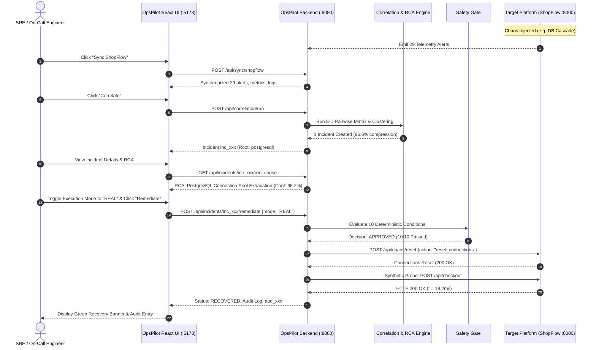

# OpsPilot — Product Requirements Document (PRD)

**Project Title:** OpsPilot — Autonomous Incident Correlation & Safe Self-Healing Infrastructure Bot  
**Document Type:** Product Requirements Document (PRD)  
**Target Systems:** Distributed Microservices & Cloud-Native Infrastructure  
**Version:** 1.0.0  
**Status:** Approved / Implemented  

---

## Table of Contents
1. [Executive Summary & Purpose](#1-executive-summary--purpose)
2. [Target Users & Personas](#2-target-users--personas)
3. [Problems Solved](#3-problems-solved)
4. [Implemented Product Features](#4-implemented-product-features)
5. [Core User Journeys & Flows](#5-core-user-journeys--flows)
6. [Functional Requirements (FR)](#6-functional-requirements-fr)
7. [Non-Functional Requirements (NFR)](#7-non-functional-requirements-nfr)
8. [System Constraints & Assumptions](#8-system-constraints--assumptions)
9. [Acceptance Criteria & Test Matrix](#9-acceptance-criteria--test-matrix)
10. [Traceability to Codebase](#10-traceability-to-codebase)

---

## 1. Executive Summary & Purpose

In modern cloud-native architectures, asynchronous cascading failures generate sudden, massive floods of telemetry ("alert storms"). When a core dependency degrades (such as a database connection pool exhaustion), dozens of upstream services simultaneously emit secondary error spikes, high latency alerts, and circuit breaker trips. Site Reliability Engineers (SREs) and on-call operators are inundated with hundreds of disjointed alerts, making it difficult to pinpoint the original root cause, prolonging Mean Time to Detect (MTTD) and Mean Time to Mitigate (MTTR).

**OpsPilot** is an autonomous, dependency-aware AIOps platform that sits out-of-band to monitor microservice topologies, ingest multi-modal telemetry streams, compress cascading alerts into unified actionable incidents using an 8-dimensional topological algorithm, identify root causes via directed acyclic graph (DAG) analysis with optional LLM reasoning, enforce a strict 10-condition deterministic safety gate, execute allowlisted remediation actions, and verify observable system recovery via live synthetic end-to-end transaction probes.

The purpose of OpsPilot is to shift on-call incident operations from reactive, manual log-trawling to deterministic, policy-governed autonomous triage and healing.

---

## 2. Target Users & Personas

| Persona | Role | Primary Goals in OpsPilot | Core Pain Points Addressed |
| :--- | :--- | :--- | :--- |
| **Site Reliability Engineer (SRE)** | On-Call Operations | Rapidly identify root causes during multi-service cascade outages; reduce alert fatigue. | 50+ alerts across different services with no clear ordering or causal hierarchy. |
| **Platform Engineer** | Infrastructure & Service Mesh Lead | Maintain service dependency topologies dynamically; enforce deterministic safety boundaries. | Stale static configuration files; unvetted automation running arbitrary shell commands. |
| **Incident Commander** | Incident Management Lead | Maintain situational awareness across affected tiers; view immutable audit logs for post-mortems. | Incomplete timeline reconstruction; ambiguity over who or what triggered a remediation script. |
| **DevOps / Backend Engineer** | Service Owner | Verify that upstream caller dependencies recover after backend remediation without manual smoke testing. | Manual checkout/curl testing during high-pressure incidents to verify if services are actually operational. |

---

## 3. Problems Solved

1. **Alert Fatigue & Cascade Noise:**
   - *Problem:* A single database failure in an e-commerce platform triggers 29+ alerts across 8 microservices within seconds.
   - *Solution:* OpsPilot correlates alerts along graph topology, causal order, and temporal proximity, compressing 29 raw alerts into 1 unified incident (a 96.6% noise reduction).
2. **Causal Ambiguity in Time-Only Clustering:**
   - *Problem:* Naive time-window grouping merges unrelated alerts occurring within the same timestamp, while missing the topological relationship between root causes and downstream symptoms.
   - *Solution:* An 8-dimensional pairwise scoring engine ([`scoring.py`](backend/app/correlation/scoring.py)) evaluates directed graph distance, causal sequence, and service adjacency.
3. **Hallucination & Risk in LLM Automation:**
   - *Problem:* Giving LLMs unrestricted access to production environments risks running destructive commands (e.g. `rm -rf`, arbitrary restarts).
   - *Solution:* Dual-engine architecture. A deterministic topological DAG traverser operates 100% offline; LLM output is strictly schema-constrained. Furthermore, remediation passes through a 10-condition deterministic safety gate before any execution.
4. **Unverified "Blind" Remediation:**
   - *Problem:* Traditional scripts execute an action and assume recovery without checking whether the user-facing transaction actually works.
   - *Solution:* Closed-loop synthetic verification probes the actual API gateway and business endpoints (e.g. `POST /api/checkout`) measuring wall-clock latency before marking an incident as `RECOVERED`.
5. **Lack of Auditability & Compliance:**
   - *Problem:* Automated actions taken during chaos events are lost in ephemeral terminal outputs.
   - *Solution:* An append-only SQLite audit repository records every gate condition, actor, execution status, and recovery evidence.

---

## 4. Implemented Product Features

### 4.1 Dynamic Topology Discovery (Grafana-Assisted)
- **Runtime Service Graph Inference:** Ingests live application telemetry (logs, health payloads, gateway routes) and optional Grafana metrics proxy to dynamically discover nodes and edges ([`discovery.py`](backend/app/topology/discovery.py)).
- **Asymptotic Confidence Accumulation:** Computes confidence for newly observed edges asymptotically from 50% up to 99%:
  $$\mathcal{C}(n) = \min\left(0.99, 0.50 + 0.25 \cdot \left(1 - e^{-n/8}\right)\right)$$
- **Zero-Downtime Fallback:** Automatically falls back to the baseline configured topology spec ([`topology.yaml`](shopflow-test/config/topology.yaml)) if telemetry is cold or Grafana is offline.

### 4.2 8-Dimensional Topological Incident Correlation
- Evaluates pairwise alert similarities using a normalized 8-D vector product:
  1. Direct Dependency ($w_1 = 0.25$)
  2. Graph Distance ($w_2 = 0.20$)
  3. Causal Sequence ($w_3 = 0.15$)
  4. Temporal Proximity ($w_4 = 0.15$)
  5. Service Adjacency ($w_5 = 0.10$)
  6. Alert Type Compatibility ($w_6 = 0.05$)
  7. Severity Transition ($w_7 = 0.05$)
  8. Metric & Tag Jaccard Similarity ($w_8 = 0.05$)
- Groups alerts into isolated incidents using single-linkage connected component clustering above a configurable similarity threshold ($\theta = 0.45$).
- Provides an automated **Correlation Benchmark Engine** comparing Dependency-Aware correlation against naive Time-Only correlation ([`BenchmarkModal.tsx`](frontend/src/components/Correlation/BenchmarkModal.tsx)).

### 4.3 Dual-Engine Root Cause Analysis (RCA)
- **Deterministic Topological Engine:** Traverses the failure DAG, scores upstream nodes by topological depth and causal alert timestamps, and isolates the root-cause service with high confidence ([`fallback.py`](backend/app/root_cause/fallback.py)).
- **Optional Grounded LLM Diagnostics:** When configured with an API key, synthesizes an executive post-mortem narrative and recommended remediation action constrained to allowlisted primitives ([`llm_client.py`](backend/app/root_cause/llm_client.py)).
- **Confidence Breakdown:** Provides a 5-dimension mathematical confidence score:
  $$\text{Score} = 0.30\cdot\text{Topo} + 0.25\cdot\text{Causal} + 0.20\cdot\text{Evidence} + 0.15\cdot\text{Breadth} + 0.10\cdot\text{Cohesion}$$

### 4.4 10-Condition Deterministic Safety Gate
- Evaluates 10 discrete safety rules before approving any remediation action ([`safety_gate.py`](backend/app/remediation/safety_gate.py)):
  1. *Incident Existence*
  2. *Actionable Incident State (`OPEN` or `INVESTIGATING`)*
  3. *Diagnosis Existence*
  4. *Root Cause Service Known*
  5. *Confidence Threshold Met ($\ge \text{min\_confidence}$, e.g. 0.80)*
  6. *Action Registered in Explicit Allowlist*
  7. *Target Service Permitted for Action*
  8. *Remediation Enabled Globally and per-Action*
  9. *No Duplicate Active/Completed Remediation (Idempotency)*
  10. *Security & Parameter Validation (Zero shell injection / banned tokens)*

### 4.5 Controlled Remediation Execution
- Supports dual execution modes:
  - **`SIMULATION` Mode (Default):** Evaluates all safety checks, executes mock recovery signals, and logs the execution without altering target services.
  - **`REAL` Mode:** Issues targeted HTTP control calls to the affected platform (e.g. `POST /api/chaos/reset` or service restart).

### 4.6 Multi-Signal Observable Recovery Verifier
- Evaluates 4 distinct live telemetry signals to confirm true system recovery ([`recovery.py`](backend/app/remediation/recovery.py)):
  1. Target Service Health Endpoint (`/health` or `/api/health-summary`)
  2. Active Alert Count (verifies zero critical alerts remaining for the target service)
  3. Error Rate & Latency Thresholds from recent metrics
  4. Active Synthetic Checkout Probe (`POST /api/checkout`) measuring wall-clock round-trip response and asserting `HTTP 200 OK`.

### 4.7 Immutable Audit Trail
- Logs every safety evaluation, decision, parameters, actor, execution result, and recovery evidence into SQLite ([`remediation_audits` table](backend/app/database/models.py)).

### 4.8 Interactive Operations Console (React 19 Frontend)
- Live React Flow interactive service topology graph with dynamic status badging (`● DYNAMICALLY DISCOVERED` vs `CONFIGURED FALLBACK`).
- Real-time KPI summary bar showing MTTR, alert compression ratio, and backend health.
- Visual Safety Gate policy matrix displaying green/red status for each of the 10 conditions.
- Step-by-step audit timeline viewer.

---

## 5. Core User Journeys & Flows

---

## 6. Functional Requirements (FR)

### Ingestion & Discovery
- **FR-1.1:** The system shall ingest services, dependencies, alerts, metrics, logs, and events via REST API (`/api/sync/shopflow`).
- **FR-1.2:** The system shall continuously observe incoming telemetry to discover dynamic topology nodes and caller-callee edges.
- **FR-1.3:** The system shall compute edge confidence asymptotically based on observation frequency.
- **FR-1.4:** The system shall gracefully fall back to a baseline YAML topology specification if external telemetry sources are unreachable.

### Correlation & Benchmark
- **FR-2.1:** The system shall calculate pairwise alert correlation scores across 8 weighted dimensions summing to 1.0.
- **FR-2.2:** The system shall cluster correlated alerts into distinct `Incident` records when pairwise similarity exceeds $\theta = 0.45$.
- **FR-2.3:** The system shall expose a benchmark endpoint (`/api/correlation/benchmark`) comparing dependency-aware clustering against naive time-window grouping.

### Root Cause Analysis (RCA)
- **FR-3.1:** The system shall determine the root-cause service by traversing the directed graph topology and ranking nodes by causal depth and alert timing.
- **FR-3.2:** The system shall compute a 5-dimension weighted confidence score for every diagnosis.
- **FR-3.3:** The system shall support offline deterministic diagnosis without requiring an active external LLM connection.

### Safety Gate & Remediation
- **FR-4.1:** The system shall evaluate 10 deterministic conditions before approving any remediation action.
- **FR-4.2:** The system shall reject any action containing shell metacharacters or banned commands (`sudo`, `rm`, `eval`, `docker`, `kubectl`).
- **FR-4.3:** The system shall support both `SIMULATION` and `REAL` execution modes.
- **FR-4.4:** The system shall enforce idempotency and reject duplicate successful remediations unless explicitly forced.

### Recovery Verification & Audit
- **FR-5.1:** The system shall evaluate target service health, active alerts, error rates, and an end-to-end synthetic transaction probe before declaring recovery.
- **FR-5.2:** The system shall record every remediation attempt, decision reason, parameter payload, and verification result in an append-only audit log.

---

## 7. Non-Functional Requirements (NFR)

- **NFR-1 (Performance & Latency):** Pairwise correlation and clustering of up to 100 alerts must complete in under $100\text{ ms}$.
- **NFR-2 (Reliability & Air-Gapped Operation):** The platform must function with 100% feature fidelity in an offline air-gapped environment without internet access.
- **NFR-3 (Safety & Blast-Radius Control):** Automated remediation must strictly prevent unauthorized commands; zero arbitrary shell scripts may be executed.
- **NFR-4 (Data Integrity):** Audit records must be immutable and persisted immediately upon execution.
- **NFR-5 (Test Coverage):** The entire backend and simulator test suite must achieve 100% pass rates (minimum 102 automated tests).

---

## 8. System Constraints & Assumptions

### Constraints
- **Runtime Environment:** Python 3.10+ for the backend; Node.js 18+ for the frontend command center.
- **Database Engine:** Embedded SQLite with Write-Ahead Logging (`opspilot.db`) to eliminate external database operational overhead.
- **Separation of Concerns:** External observability platforms (e.g. Grafana) are strictly read-only telemetry providers. OpsPilot retains exclusive control over correlation, safety gating, and remediation execution.

### Assumptions
- *Target Application Telemetry:* The monitored system (ShopFlow) exposes standardized health checks, telemetry endpoints, and a reset/recovery endpoint.
- *Single-Tenant Demonstration:* The system is designed for single-cluster operational command; multi-tenant tenancy partitioning is not implemented in the prototype.

---

## 9. Acceptance Criteria & Test Matrix

| ID | Requirement | Acceptance Criteria | Verified Test File |
| :--- | :--- | :--- | :--- |
| **AC-1** | 8-D Correlation Noise Reduction | 29 cascade alerts compressed into exactly 1 incident ($\ge 95\%$ compression). | [`test_correlation.py`](backend/tests/test_correlation.py) |
| **AC-2** | Topological RCA Accuracy | PostgreSQL connection pool identified as root cause with $\ge 90\%$ confidence. | [`test_root_cause.py`](backend/tests/test_root_cause.py) |
| **AC-3** | Safety Gate Banned Tokens | Requests containing `sudo` or `; rm -rf` rejected by Condition 10. | [`test_remediation.py`](backend/tests/test_remediation.py) |
| **AC-4** | Dynamic Topology Edge Accumulation | Edge confidence increases asymptotically with repeated evidence. | [`test_topology_discovery.py`](backend/tests/test_topology_discovery.py) |
| **AC-5** | Synthetic Probe Verification | Probing checkout endpoint returns `HTTP 200 OK` in $< 50\text{ ms}$. | [`test_recovery.py`](backend/tests/test_recovery.py) |
| **AC-6** | Automated Test Suite | All 102 unit, integration, and chaos tests pass without error. | `pytest backend/tests shopflow-test/tests` |

---

## 10. Traceability to Codebase

- **Backend Entrypoint:** [`backend/app/main.py`](backend/app/main.py)
- **Correlation Engine:** [`backend/app/correlation/service.py`](backend/app/correlation/service.py)
- **Scoring Formulas:** [`backend/app/correlation/scoring.py`](backend/app/correlation/scoring.py)
- **Deterministic RCA:** [`backend/app/root_cause/fallback.py`](backend/app/root_cause/fallback.py)
- **Safety Gate:** [`backend/app/remediation/safety_gate.py`](backend/app/remediation/safety_gate.py)
- **Recovery Prober:** [`backend/app/remediation/recovery.py`](backend/app/remediation/recovery.py)
- **Topology Discovery:** [`backend/app/topology/discovery.py`](backend/app/topology/discovery.py)
- **Frontend Dashboard:** [`frontend/src/App.tsx`](frontend/src/App.tsx)
- **ShopFlow Simulator:** [`shopflow-test/services/api_gateway/main.py`](shopflow-test/services/api_gateway/main.py)
